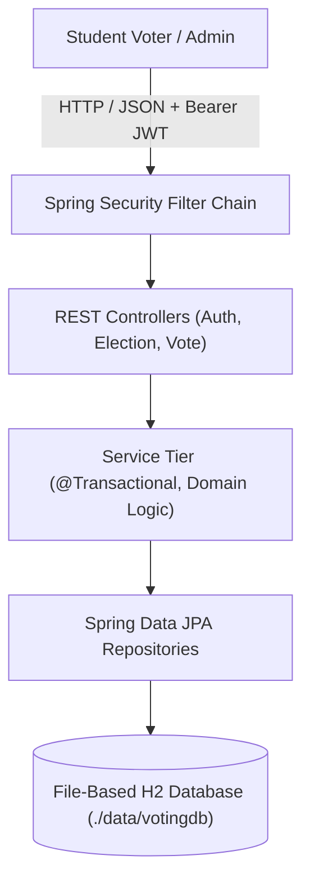

# 🗳️ College Voting System

[](https://www.oracle.com/java/)
[](https://spring.io/projects/spring-boot)
[](https://spring.io/projects/spring-security)
[](https://www.h2database.com/)
[](https://maven.apache.org/)
[](LICENSE)

An audit-compliant, privacy-preserving institutional voting web application built for college elections (Student Council, Department Representatives, Club Executives). Designed and implemented following academic security standards, robust database constraints, and enterprise Spring Boot patterns.

Developed by **Ganesh** for academic project submission and viva voce evaluation (15 marks + 1 bonus).

---

## 🌟 Key Features & Democratic Guarantees

1. **Secret Ballot (Voter Anonymity):**
   - Implements a **detached dual-entity database architecture**.
   - `VoterParticipation` logs THAT a student voted to prevent double-voting.
   - `Ballots` stores the vote with **strictly ZERO link, foreign key, or reference to the voter**.
2. **Double-Voting Concurrency Prevention:**
   - Two-tier protection: fast application-level checks and a hard database unique constraint `uk_user_election_participation (user_id, election_id)`.
   - Multi-threaded race conditions automatically trigger `DataIntegrityViolationException` and return `HTTP 409 Conflict`.
3. **Strict Election Lifecycle State Machine:**
   - Non-reversible transitions: `DRAFT` ➔ `UPCOMING` ➔ `ACTIVE` ➔ `CLOSED`.
   - Candidate nominations and election windows cannot be tampered with once voting commences.
4. **Results Embargo:**
   - Tallies and winner statistics are hidden from voters while voting is active and remain embargoed until an administrator reviews turnout and explicitly publishes results.
5. **No Mutable Counter Flaws:**
   - The `Candidates` entity contains **no `voteCount` column**. Results are computed by aggregating authentic rows in `Ballots`, preventing lost updates under heavy load.
6. **Stateless JWT Security & RBAC:**
   - Secure HMAC-SHA256 token authentication with BCrypt password hashing.
   - Separate privileges for `ADMIN` (election management, candidate nomination, turnout audit) and `VOTER` (ballot casting).
7. **Interactive Single Page Application (SPA):**
   - Modern responsive UI styled with Tailwind CSS, Outfit/Inter typography, and glassmorphism.
   - Features voter dashboard, candidate manifestos, review confirmation modal, debounced voting buttons, and live results visualization.

---

## 🏗️ Architecture Overview



---

## 🚀 Quick Start Guide

### Prerequisites
- **Java Development Kit (JDK):** Version 21 or higher.
- **Git:** Version 2.40 or higher.
- *(Maven is bundled via `mvnw` / `mvnw.cmd` - no manual install required).*

### Running the Application Locally

1. **Clone the repository:**
   ```bash
   git clone https://github.com/ganesh/college-voting-system.git
   cd college-voting-system
   ```

2. **Launch the Spring Boot Server:**
   - On Windows:
     ```cmd
     mvnw.cmd spring-boot:run
     ```
   - On Linux/macOS:
     ```bash
     ./mvnw spring-boot:run
     ```

3. **Access the Portal:**
   - **Web Application:** [http://localhost:8080](http://localhost:8080)
   - **Interactive Swagger UI:** [http://localhost:8080/swagger-ui/index.html](http://localhost:8080/swagger-ui/index.html)
   - **OpenAPI 3.0 JSON:** [http://localhost:8080/v3/api-docs](http://localhost:8080/v3/api-docs)
   - **H2 Database Console:** [http://localhost:8080/h2-console](http://localhost:8080/h2-console)

---

## 🔑 Pre-Seeded Demo Credentials

The development profile (`dev`) automatically seeds initial institutional accounts for testing:

| Role | Roll Number | Password | Capabilities |
|---|---|---|---|
| **Admin** | `ADM001` | `AdminSecure@123` | Create elections, nominate candidates, audit turnout, close elections, publish results |
| **Demo Voter 1** | `24CS001` | `VoterSecure@123` | View active elections, view candidate manifestos, cast ballot |
| **Demo Voter 2** | `24CS002` | `VoterSecure@123` | Alternate voter account |
| **Demo Voter 3** | `24CS003` | `VoterSecure@123` | Alternate voter account |

*(Tip: The login screen has quick one-click demo login buttons for immediate convenience).*

---

## 🗄️ Database Inspection (H2 Web Console)

You can inspect the live database directly in your browser:
- **URL:** [http://localhost:8080/h2-console](http://localhost:8080/h2-console)
- **JDBC URL:** `jdbc:h2:file:./data/votingdb`
- **User Name:** `sa`
- **Password:** *(leave blank)*

### Key Audit Queries:
```sql
-- 1. Inspect Participation Turnout (Audit log of WHO voted)
SELECT u.roll_number, u.full_name, vp.voted_at 
FROM voter_participation vp 
JOIN users u ON vp.user_id = u.id;

-- 2. Inspect Anonymous Ballots (Observe that there is NO user column)
SELECT b.id, b.election_id, c.name AS candidate_name, b.cast_time 
FROM ballots b 
JOIN candidates c ON b.candidate_id = c.id;

-- 3. Live Vote Aggregation
SELECT c.name, COUNT(b.id) AS total_votes 
FROM candidates c 
LEFT JOIN ballots b ON c.id = b.candidate_id 
GROUP BY c.id, c.name;
```

---

## 🧪 Comprehensive Automated Testing

The project maintains **100% pass rates across 46 unit, mock, security, and integration tests**:

```bash
./mvnw clean test
```

### Test Suite Structure:
- `VotingLifecycleIntegrationTest`: End-to-end simulation from election creation, voter registration, anonymous ballot casting, double-vote rejection, turnout audit, to results publication.
- `ConcurrencyAndEmbargoIntegrationTest`: Uses `ExecutorService` and `CountDownLatch` to fire simultaneous voting requests on concurrent threads and asserts that exactly 1 succeeds and 1 fails with `HTTP 409 Conflict`.
- `SecurityAccessTest`: Verifies Spring Security filter chain, unauthenticated 401s, voter 403s on admin endpoints, and JWT claims.
- `VotingServiceTest` & `ElectionAndUserServiceTest`: Mockito unit tests verifying business rules, rollback logic, and validation.
- Controller WebMvc Tests: Validates HTTP status codes (200, 201, 204, 400, 401, 403, 404, 409) and error payloads.

---

## 🔒 Privacy Analysis & Limitations

### Privacy Guarantees
- **Separation:** `VOTER_PARTICIPATION` and `BALLOTS` are distinct tables stored without relational linkages.
- **Integrity:** Transactions are atomic; a ballot cannot exist without a corresponding participation record, guaranteeing that fake ballots cannot be inserted.

### Known Limitations & Mitigations
- **Timing Correlation:** If a voter casts a ballot at 02:14:15 PM and only one row exists in both `VOTER_PARTICIPATION` and `BALLOTS` with that timestamp, an attacker with full database read access could infer the choice.
  - *Mitigation for Production:* Implement artificial timestamp jitter (e.g. truncate timestamps to 10-minute intervals or batch-commit ballots).
- **Small-Electorate Exhaustion:** In elections with 100% turnout for a single candidate, voter choices are trivially inferred.
  - *Mitigation for Production:* Enforce minimum electorate size and quorum rules.

---

## 📚 Project Documentation Links

- **[REST API Specification](docs/API.md):** Complete endpoint matrix, JSON request/response formats, and HTTP status codes.
- **[System Design & Architecture](docs/DESIGN.md):** Detailed Mermaid diagrams covering ER models, sequence flows, and state machines.
- **[Viva Voce Preparation Guide](docs/VIVA_NOTES.md):** 15 in-depth interview questions and answers + 5 live-editing challenge drills.
- **[Postman Collection](postman/voting-system.postman_collection.json):** Ready-to-import Postman v2.1.0 collection with dynamic environment scripting.

---

## 📄 License
This project was developed for academic assessment at Apex Institute of Technology under the Academic Free License.
