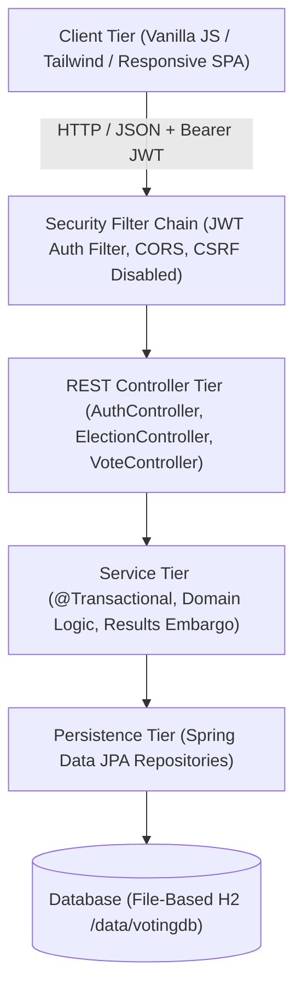
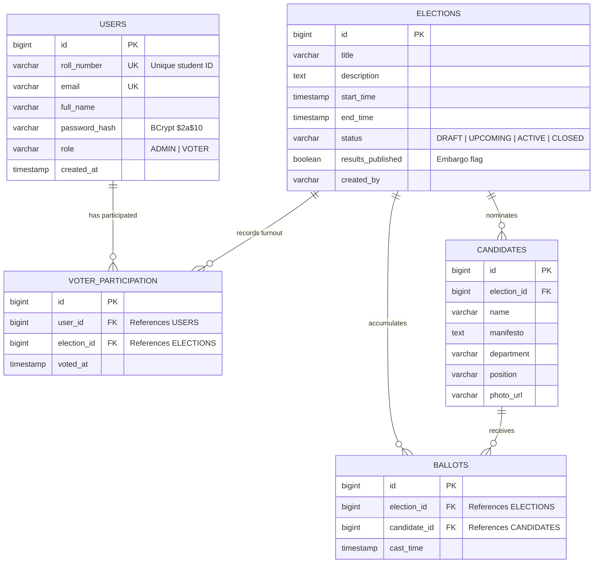
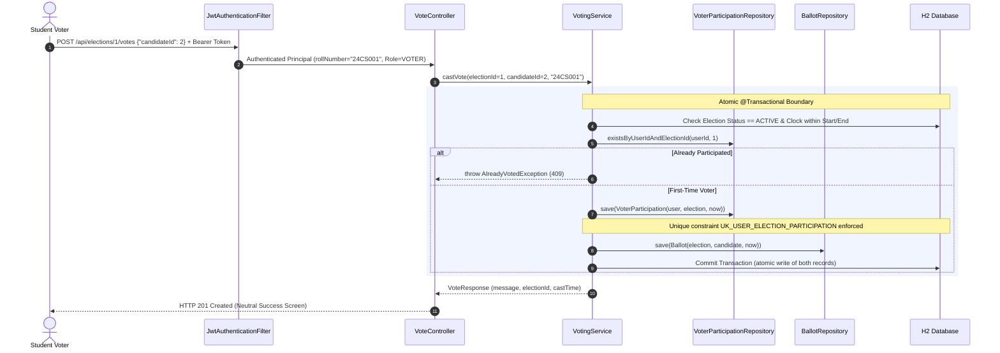
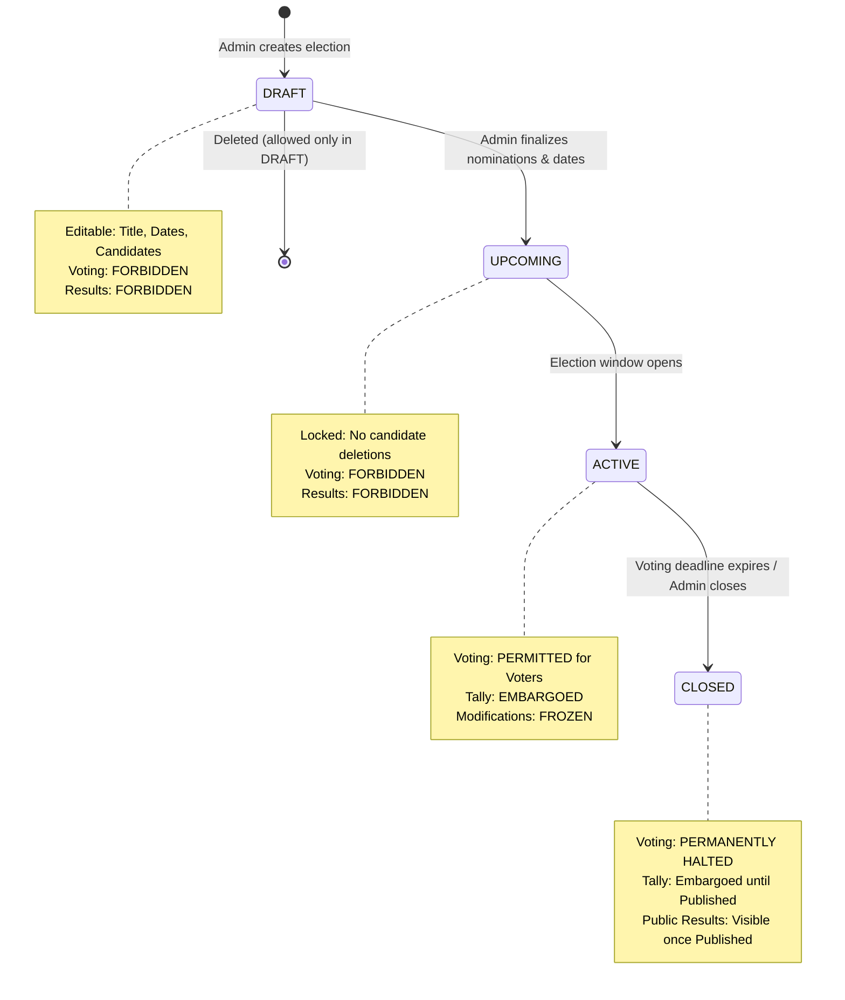

# College Voting System — Architecture & System Design

This document details the architectural decisions, database models, cryptographic security guarantees, and transaction boundaries implemented in the College Voting System.

---

## 1. High-Level Layered Architecture

The application adopts a clean, decoupled 4-tier layered architecture adhering to Spring Boot enterprise best practices:



---

## 2. Privacy-Preserving Database Schema (ER Diagram)

A core requirement of institutional democracy is the **Secret Ballot**: it must be mathematically and architecturally impossible for any database administrator, faculty member, or hacker to correlate a specific student with their chosen candidate.



### Architectural Privacy Proof:
1. **Separation of Concerns:**
   - `VOTER_PARTICIPATION` answers the audit question: *"Did Student 24CS001 participate in Election #1?"*
   - `BALLOTS` answers the tally question: *"How many total votes were cast for Candidate Priya Patel in Election #1?"*
2. **Zero Foreign Key:**
   - The `BALLOTS` table contains strictly **NO `user_id` foreign key**, no IP address, no user agent, and no student roll number.
3. **No `voteCount` in `CANDIDATES` Table:**
   - Candidates do not store mutable counters (`voteCount`). Instead, certified totals are computed by aggregating individual anonymous records in `BALLOTS`. This eliminates lost updates under concurrency.

---

## 3. Atomic Voting Transaction (Sequence Diagram)

When a student clicks "Confirm & Cast My Ballot", the backend executes an atomic database transaction wrapped with `@Transactional(rollbackFor = Exception.class)`:



---

## 4. Double-Voting Concurrency Mitigation

In high-concurrency scenarios (e.g. thousands of students voting in the final minutes), an attacker might fire two simultaneous requests on separate threads to cast two votes before the first request finishes:

```text
Thread A: Read participation -> Not found ---------> Insert Participation -> Insert Ballot -> OK
Thread B: Read participation -> Not found ---------> Insert Participation -> DB Constraint Violation!
```

### Two-Tier Protection Mechanism:
1. **Tier 1 (Application Level):**
   `voterParticipationRepository.existsByUserIdAndElectionId(...)` serves as a fast early-return guard.
2. **Tier 2 (Database Level - ACID Guarantee):**
   A composite unique constraint is declared on `VOTER_PARTICIPATION`:
   ```sql
   CONSTRAINT uk_user_election_participation UNIQUE (user_id, election_id)
   ```
   If two threads bypass the application check simultaneously, the underlying database enforces the unique index, rejects the second thread with `DataIntegrityViolationException`, and rolls back the entire transaction. The exception handler converts this to `HTTP 409 Conflict`.

---

## 5. Election Lifecycle State Machine

An election progresses through strict, non-reversible lifecycle phases managed by authorized administrators:



---

## 6. Results Embargo Architecture

To prevent early results from influencing voting behavior or causing voter suppression, results are strictly **embargoed**:
1. During `ACTIVE` status, the `/api/elections/{id}/results` endpoint rejects voter requests with `400 Bad Request` (`ELECTION_STILL_ACTIVE`).
2. Once status is `CLOSED`, the results remain hidden from standard voters (`403 Forbidden` `RESULTS_EMBARGOED`) until an administrator explicitly reviews the turnout and triggers:
   ```http
   PATCH /api/elections/{id}/results-visibility {"published": true}
   ```
3. Once published, all voters and guests can view certified vote tallies, percentage breakdowns, and winner announcements.
